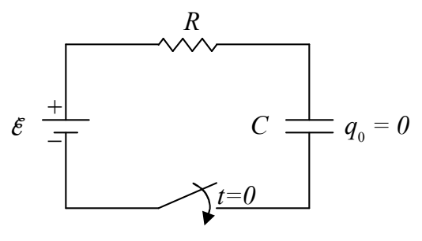
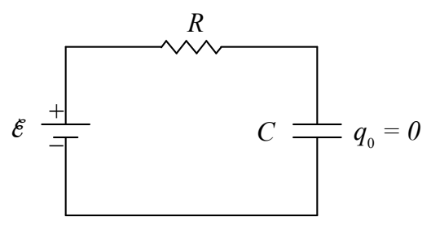

Substituting our expression $V_0 e^{-\frac{t}{RC}}$ in for $V$ turns this equation $\left( I = \frac{V}{R} \right)$ into:

$$I = \frac{V_0 e^{-\frac{t}{RC}}}{R}$$

But, $\frac{V_0}{R}$ is just $I_0$ (from $V_0 = I_0 R$ solved for $I_0$), the current at the time 0, so:

$$I = I_0 e^{-\frac{t}{RC}} \tag{13-3}$$

Summarizing, we note that all three of the quantities, $V, I,$ and $q$ decrease exponentially with time.

## Charging Circuit

Consider the following circuit, containing an initially-uncharged capacitor, and

annotated to indicate that the switch is closed at time 0 at which point the circuit becomes:

Let’s think about what will happen as time elapses. With no charge on the capacitor, the voltage across it is zero, meaning the potential of the right terminal of the resistor is the same as the potential of the lower-potential terminal of the seat of EMF. Since the left end of the resistor is connected to the higher-potential terminal of the seat of EMF, this means that at time 0, the
