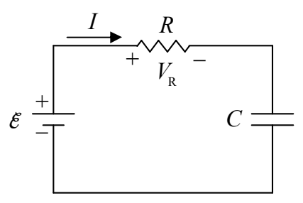
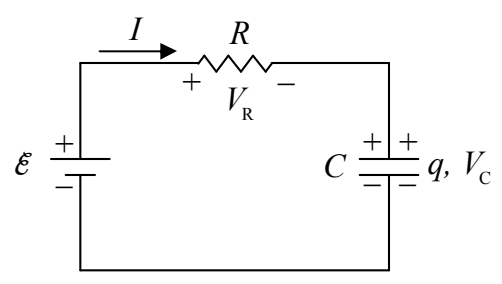

voltage across the resistor is equivalent to the EMF $\mathcal{E}$ of the seat of EMF. Thus, there will be a rightward current through the resistor.

The positive charge flowing through the resistor has to come from someplace. Where does it come from? Answer: The bottom plate of the capacitor. Also, charge can’t flow through an ideal capacitor. So where does it go? It piles up on the top plate of the capacitor.

The capacitor is becoming charged. As it does, the voltage across the capacitor increases, meaning the potential of the right terminal of the resistor (relative to the potential of the lower-potential terminal of the seat of EMF) increases. The potential of the left terminal of the resistor remains constant, as dictated by the seat of EMF. This means that the voltage across the resistor continually decreases. This, in turn; from $V_R = IR$, written as $I = V_R/R$, means that the current continually decreases. This occurs until there is so much charge on the capacitor that $V_c = \mathcal{E}$, meaning that $V_R = 0$ so $I = 0$.

Recapping our conceptual discussion:

At time 0, we close the switch:

- The charge on the capacitor starts off at 0 and builds up to $q = C\mathcal{E}$ where $\mathcal{E}$ is the EMF voltage.
- The capacitor voltage starts off at 0 and builds up to the EMF voltage $\mathcal{E}$.
- The current starts off at $I_0 = \frac{\mathcal{E}}{R}$ and decreases to 0.
