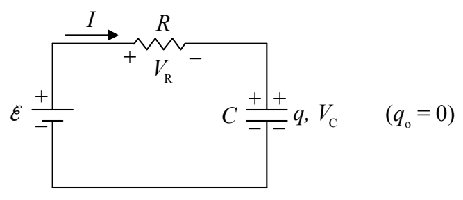
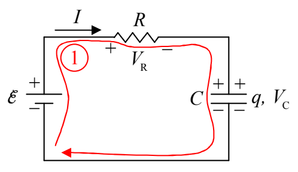

Okay, we have a qualitative understanding of what happens. Let’s see if we can obtain formulas for $V_{\text{R}}$, $I$, $V_{\text{C}}$, and $q$ as functions of time. Here’s the circuit:

We apply the loop rule:

KVL ①

$$+\mathcal{E} - V_{\text{R}} - V_{\text{C}} = 0$$

and the definitions of resistance and capacitance:

$$V_{\text{R}} = IR$$

$$q = CV_C$$

$$V_C = \frac{q}{C}$$

to obtain:

$$\mathcal{E} - IR - \frac{q}{C} = 0$$

$$IR + \frac{q}{C} = \mathcal{E}$$
