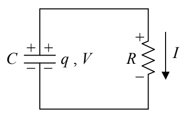
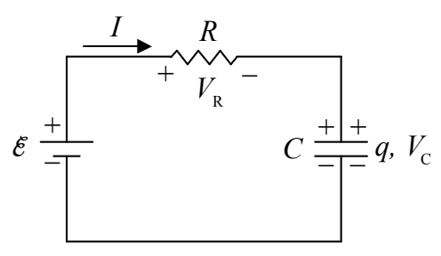

$$V_R = \mathcal{E} - \mathcal{E} + \mathcal{E} e^{-\frac{t}{RC}}$$

$$V_R = \mathcal{E} e^{-\frac{t}{RC}}$$

From our definition of resistance:

$$V_R = IR$$
$$I = \frac{V_R}{R}$$

with $V_R = \mathcal{E} e^{-\frac{t}{RC}}$, this can be expressed as:

$$I = \frac{\mathcal{E}}{R} e^{-\frac{t}{RC}}$$

At time 0, this evaluates to $\mathcal{E}/R$ meaning that $\mathcal{E}/R$ can be interpreted as the current at time 0 allowing us to write our function $I(t)$ as

$$I = I_0 e^{-\frac{t}{RC}}$$

Our formula has the current starting out at its maximum value and decreasing exponentially with time, as anticipated based on our conceptual understanding of the circuit. Note that this is the same formula that we got for the current in the discharging-capacitor circuit. In both cases, the current dies off exponentially. The reasons differ, but the effect $(I = I_0 e^{-\frac{t}{RC}})$ is the same:

In the discharging-capacitor circuit, the current dies off because the capacitor runs out of charge.

In the charging-capacitor circuit, the current dies off because the capacitor voltage, which counteracts the EMF, builds up to $\mathcal{E}$ as the capacitor charges.
