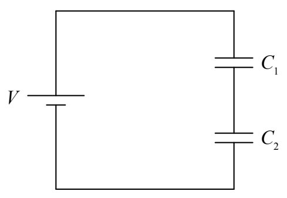
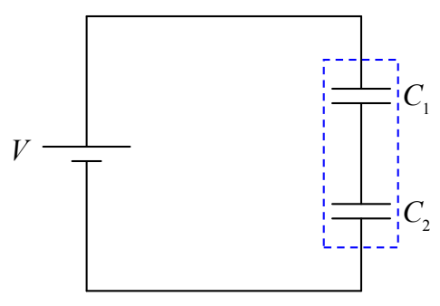
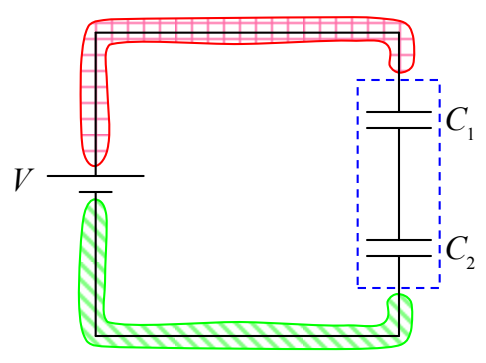

## 14 Capacitors in Series & Parallel

The method of ever-simpler circuits that we used for circuits with more than one resistor can also be used for circuits having more than one capacitor. The idea is to replace a combination circuit element consisting of more than one capacitor with a single equivalent capacitor. The equivalent capacitor should be equivalent in the sense that, with the same potential across it, it will have the same charge as the combination circuit element.

## Capacitors in Series

Let's start with a case in which the combination circuit element consists of two capacitors in series with each other:

We consider the two capacitors to be a two-terminal combination circuit element:

The voltage across the combination circuit element is clearly the EMF voltage $V$ since, for both the seat of EMF and the combination circuit element, we're talking about the potential difference between the same two conductors:

