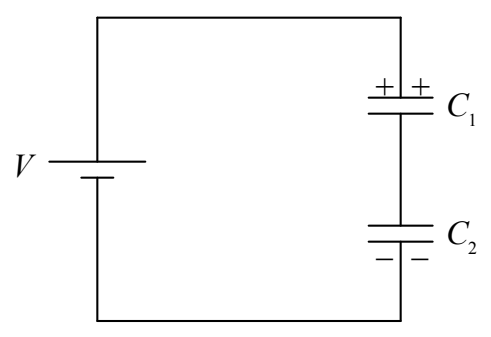
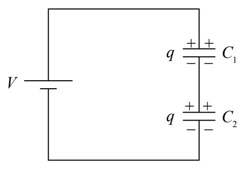

The voltage across each individual capacitor is, however, not known.

But consider this: After that last wire is connected in the circuit, the charging process (which takes essentially no time at all) can be understood to proceed as follows (where, for ease of understanding, we describe things that occur simultaneously as if they occurred sequentially):

The seat of EMF pulls some positive charge from the bottom plate of the lower capacitor and pushes it onto the top plate of the upper capacitor.

The key point about this movement of charge is that the amount of positive charge on the top plate of the upper capacitor is exactly equal to the amount of negative charge on the bottom plate of the lower capacitor (because that’s where the positive charge came from!)

Now, the positive charge on the upper plate of the top capacitor repels the positive charge (remember, every neutral object consists of huge amounts of both kinds of charge, and, in our positive-charge-carrier convention, the positive charges are free to move) on the bottom plate of the upper capacitor and that charge has a conducting path to the top plate of the lower capacitor, to which it (the positive charge) is attracted by the negative charge on the bottom plate of the lower capacitor.

The final result is that both capacitors have one and the same charge $q$:

