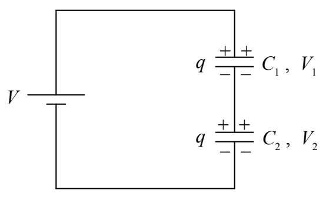
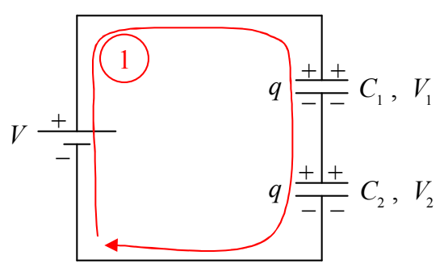

which in turn causes capacitor $C_1$ to have voltage $V_1 = \frac{q}{C_1}$ and capacitor $C_2$ to have voltage

$$V_2 = \frac{q}{C_2}.$$

By the loop rule,

KVL ①

$$
V - V_1 - V_2 = 0
$$

$$
V = V_1 + V_2
$$

$$
V = \frac{q}{C_1} + \frac{q}{C_2}
$$

$$
V = q \left( \frac{1}{C_1} + \frac{1}{C_2} \right)
$$

$$
q = \frac{1}{\frac{1}{C_1} + \frac{1}{C_2}} V
$$
