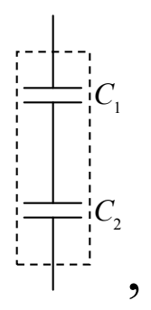
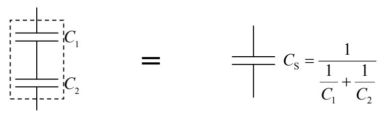

So, what we’re saying is, that when you put a voltage $V$ across the two-terminal circuit element

an amount of charge $q = \frac{1}{\frac{1}{C_1} + \frac{1}{C_2}} V$ is moved from the bottom terminal of the combination circuit element, around the circuit, to the top terminal. Then charge stops moving. Recall that we defined the capacitance of a capacitor to be the ratio $\frac{q}{V}$ of the charge on the capacitor to the corresponding voltage across the capacitor. $\frac{q}{V}$ for our two-terminal combination circuit element is thus the equivalent capacitance of the two terminal circuit element. Solving $q = \frac{1}{\frac{1}{C_1} + \frac{1}{C_2}} V$ for the ratio $\frac{q}{V}$ yields $\frac{q}{V} = \frac{1}{\frac{1}{C_1} + \frac{1}{C_2}}$ so our equivalent capacitance for two capacitors in series is $C_S = \frac{1}{\frac{1}{C_1} + \frac{1}{C_2}}$

By logical induction, we can extend this argument to cover any number of capacitors in series with each other, obtaining:

$$C_S = \frac{1}{\frac{1}{C_1} + \frac{1}{C_2} + \frac{1}{C_3} + \ldots} \tag{14-1}$$

As far as making things easy to remember, it’s just too bad the way things work out sometimes. This expression is mathematically identical to the expression for resistors in parallel. But, this expression is for capacitors in series.
