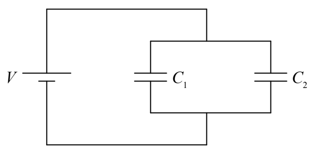
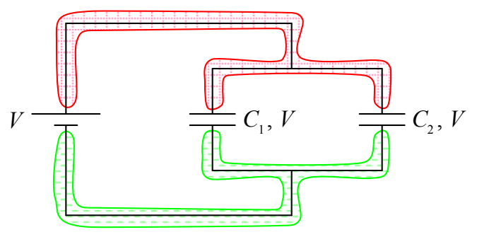
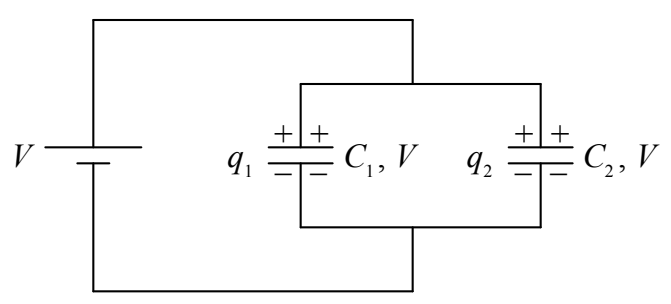

## Capacitors in Parallel

Suppose we put a voltage V across a combination circuit element consisting of a pair of capacitors in parallel with each other:

It is clear from the diagram that the voltage across each capacitor is just the EMF V since the voltage across every component in the circuit is the potential difference between the same two conductors.

So what happens (almost instantaneously) when we make that final connection? Answer: The seat of EMF pulls charge off the bottom plates of the two capacitors and pushes it onto the top plates until the charge on  $C_{1}$  is  $q_{1}=C_{1}V$  and the charge on  $C_{2}$  is  $q_{2}=C_{2}V$ .

To do that, the seat of EMF has to move a total charge of

$$q = q _ {1} + q _ {2}$$

$$q = C _ {1} V + C _ {2} V$$

$$q = (C _ {1} + C _ {2}) V$$
