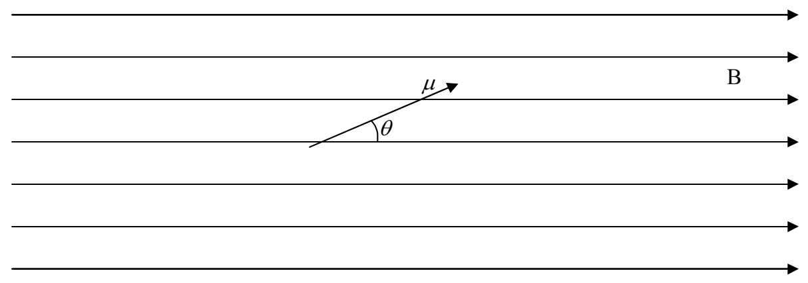

For the cross product of any two vectors, the magnitude of the cross product is the product of the magnitudes of the two vectors, times the sine of the angle the two vectors form when placed tail to tail. In the case of $\vec{\tau} = \vec{\mu} \times \vec{B}$, this means:

$$
\tau = \mu B \sin \theta
$$

In the SI system of units, torque has units of N·m (newton-meters). For the units on the right side of $\tau = \mu B \sin \theta$ to work out to be N·m, what with $\mu$ having units of electric dipole moment (A·m$^{2}$) and $\sin \theta$ having no units at all, $B$ must have units of torque-per-magnetic-dipole-moment, namely, $\frac{N \cdot m}{A \cdot m^{2}}$. That combination unit is given a name. It is called the tesla, abbreviated T.

$$
1 \mathrm{T} = 1 \frac {\mathrm{N} \cdot \mathrm{m}}{\mathrm{A} \cdot \mathrm{m} ^ {2}}
$$

## Example 15-1

Consider a magnetic dipole having a magnetic dipole moment $\mu=0.045\ A\cdot m^{2}$, oriented so that it makes an angle of $23^{\circ}$ with the direction of a uniform magnetic field of magnitude $5.0\times10^{-5}$ T as depicted below. Find the torque exerted on the magnetic dipole, by the magnetic field.

Recall that the arrowhead represents the north pole of the bar magnet that a magnetic dipole is. The direction of the torque is such that it tends to cause the magnetic dipole to point in the direction of the magnetic field. For the case depicted above, that would be clockwise as viewed from the vantage point of the creator of the diagram. The magnitude of the torque for such a case can be calculated as follows:

$$
\tau = \mu B \sin \theta
$$

$$
\tau = \left(. 0 4 5 \mathrm{A} \cdot \mathrm{m} ^ {2}\right) \left(5. 0 \times 1 0 ^ {- 5} \mathrm{T}\right) \sin 2 3 ^ {\circ}
$$

$$
\tau = 8. 8 \times 1 0 ^ {- 7} \mathrm{A} \cdot \mathrm{m} ^ {2} \cdot \mathrm{T}
$$
