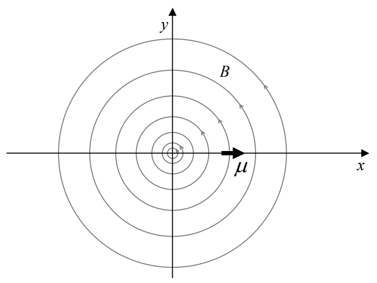

*Solution*: First, we sketch the configuration:

Substituting the given $\vec{\boldsymbol{\mu}}$ and $\vec{\mathbf{B}}$, into our expression for the force yields:

$$\vec{\mathbf{F}}_\text{B} = \nabla(\vec{\boldsymbol{\mu}} \cdot \vec{\mathbf{B}})$$

$$\vec{\mathbf{F}}_\text{B} = \nabla[(.514\ \text{A} \cdot \text{m}^2\ \hat{\imath}) \cdot (-5.82 \times 10^{-6}\ \text{T} \cdot \text{m} \frac{y}{x^2 + y^2}\ \hat{\imath} + 5.82 \times 10^{-6}\ \text{T} \cdot \text{m} \frac{x}{x^2 + y^2}\ \hat{\jmath})]$$

$$\vec{\mathbf{F}}_\text{B} = \nabla \left( -2.99 \times 10^{-6}\ \text{A} \cdot \text{m}^2 \cdot \text{T} \cdot \text{m} \frac{y}{x^2 + y^2} \right)$$

$$\vec{\mathbf{F}}_\text{B} = -2.99 \times 10^{-6}\ \text{N} \cdot \text{m}^2\ \nabla[y(x^2 + y^2)^{-1}]$$

$$\vec{\mathbf{F}}_\text{B} = -2.99 \times 10^{-6}\ \text{N} \cdot \text{m}^2 \left\{ \frac{\partial}{\partial x}[y(x^2 + y^2)^{-1}]\ \hat{\imath} + \frac{\partial}{\partial y}[y(x^2 + y^2)^{-1}]\ \hat{\jmath} + \frac{\partial}{\partial z}[y(x^2 + y^2)^{-1}]\ \hat{k} \right\}$$

$$\vec{\mathbf{F}}_\text{B} = -2.99 \times 10^{-6}\ \text{N} \cdot \text{m}^2\ \{[y(-1)(x^2 + y^2)^{-2} 2x\ \hat{\imath} + [(x^2 + y^2)^{-1} + y(-1)(x^2 + y^2)^{-2} 2y]\ \hat{\jmath} + 0\ \hat{k}\}$$

$$\vec{\mathbf{F}}_\text{B} = -2.99 \times 10^{-6}\ \text{N} \cdot \text{m}^2 \left\{ -\frac{2xy}{(x^2 + y^2)^2}\ \hat{\imath} + \left[ \frac{1}{x^2 + y^2} - \frac{2y^2}{(x^2 + y^2)^2} \right] \hat{\jmath} \right\}$$

Recalling that we have to evaluate this expression at the location of the victim, a location that was given as (0.110 m, 0, 0), we find that:
