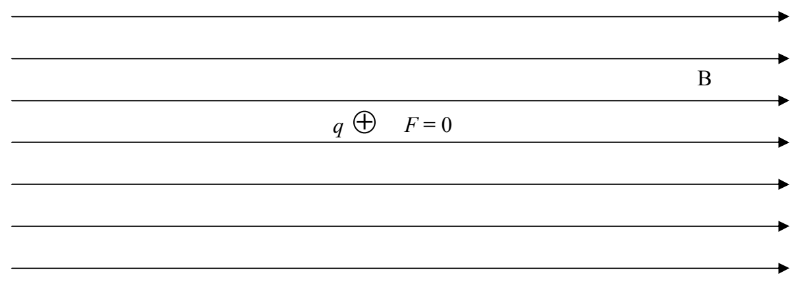
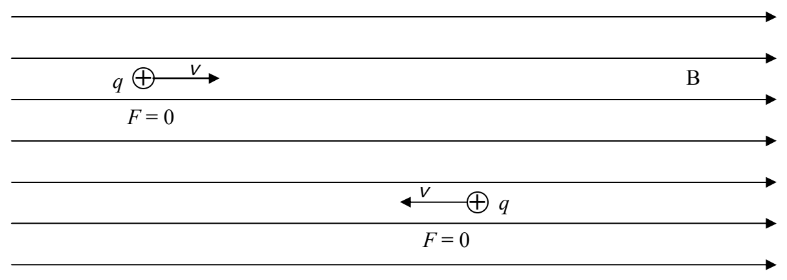

## 16 Magnetic Field: More Effects

The electric field and the magnetic field are not the same thing. An electric dipole with positive charge on one end and negative charge on the other is not the same thing as a magnetic dipole having a north and a south pole. More specifically: An object can have positive charge but it can't have “northness”.

On the other hand, electricity and magnetism are not unrelated. In fact, under certain circumstances, a magnetic field will exert a force on a charged particle that has no magnetic dipole moment. Here we consider the effect of a magnetic field on such a charged particle.

FACT: A magnetic field exerts no force on a charged particle that is at rest in the magnetic field.

FACT: A magnetic field exerts no force on a charged particle that is moving along the line along which the magnetic field, at the location of the particle, lies.

