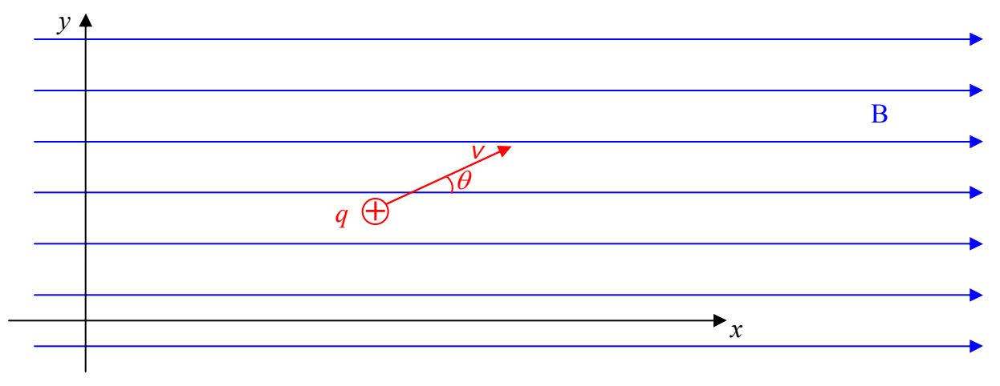
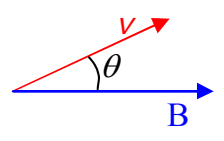

FACT: A magnetic field does exert a force on a charged particle that is in the magnetic field, and, is moving, as long as the velocity of the particle is not along the line, along which, the magnetic field is directed. The force in such a case is given by:

\[
\overrightarrow {\mathbf {F}} = q \overrightarrow {\mathbf {v}} \times \overrightarrow {\mathbf {B}} \tag {16-1}
\]

Note that the cross product yields a vector that is perpendicular to each of the multiplicands. Thus the force exerted on a moving charged particle by the magnetic field within which it finds itself, is always perpendicular to both its own velocity, and the magnetic field vector at the particle’s location.

Consider a positively-charged particle moving with velocity $v$ at angle $\theta$ in the x-y plane of a Cartesian coordinate system in which there is a uniform magnetic field in the +x direction.

To get the magnitude of the cross product $\vec{\mathbf{v}} \times \vec{\mathbf{B}}$ that appears in $\vec{\mathbf{F}} = q \vec{\mathbf{v}} \times \vec{\mathbf{B}}$ we are supposed to establish the angle that $\vec{\mathbf{v}}$ and $\vec{\mathbf{B}}$ make with each other when they are placed tail to tail. Then the magnitude $|\vec{\mathbf{v}} \times \vec{\mathbf{B}}|$ is just the absolute value of the product of the magnitudes of the vectors times the sine of the angle in between them. Let’s put the two vectors tail to tail and establish that angle. Note that the magnetic field as a whole is an infinite set of vectors in the +x direction. So, of course, the magnetic field vector $\vec{\mathbf{B}}$, at the location of the particle, is in the +x direction.

Clearly the angle between the two vectors is just the angle $\theta$ that was specified in the problem. Hence,

$$
\left| \vec{\mathbf{v}} \times \vec{\mathbf{B}} \right| = \left| v B \sin \theta \right| ,
$$
