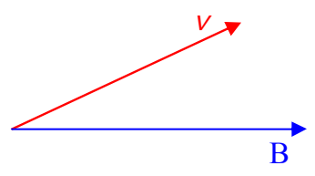
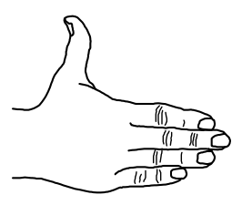
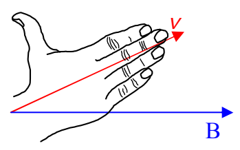

so, starting with our given expression for $\vec{F}$, we have:

$$\vec{F} = q \vec{v} \times \vec{B}$$

$$|\vec{F}| = |q \vec{v} \times \vec{B}|$$

$$|\vec{F}| = |q v B \sin \theta|$$

Okay, now let’s talk about the direction of $\vec{F} = q \vec{v} \times \vec{B}$. We get the direction of $\vec{v} \times \vec{B}$ and then we think. The charge $q$ is a scalar. If $q$ is positive, then, when we multiply the vector $\vec{v} \times \vec{B}$ by $q$ (to get $\vec{F}$), we get a vector in the same direction as that of $\vec{v} \times \vec{B}$. So, whatever we get (using the right-hand rule for the cross product) for the direction of $\vec{v} \times \vec{B}$ is the direction of $\vec{F} = q \vec{v} \times \vec{B}$.

But, if $q$ is negative, then, when we multiply the vector $\vec{v} \times \vec{B}$ by $q$ (to get $\vec{F}$), we get a vector in opposite direction to that of $\vec{v} \times \vec{B}$. So, once we get the direction of $\vec{v} \times \vec{B}$ by means of the right-hand rule for the cross product of two vectors, we have to realize that (because the charge is negative) the direction of $\vec{F} = q \vec{v} \times \vec{B}$ is opposite the direction that we found for $\vec{v} \times \vec{B}$.

Let’s do it. To get the direction of the cross product vector $\vec{v} \times \vec{B}$ (which appears in $\vec{F} = q \vec{v} \times \vec{B}$), draw the vectors $\vec{v}$ and $\vec{B}$ tail to tail.

Extend the fingers of your right hand so that they are pointing directly away from your right elbow. Extend your thumb so that it is at right angles to your fingers.

Now, keeping your fingers aligned with your forearm, align your fingers with the first vector appearing in the cross product $\vec{v} \times \vec{B}$, namely $\vec{v}$.

