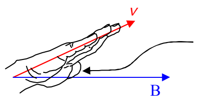
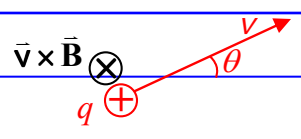
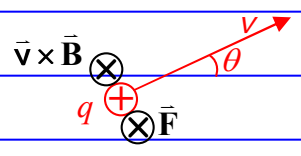

Now rotate your hand, as necessary, about an imaginary axis extending along your forearm and along your middle finger, until your hand is oriented such that, if you were to close your fingers, they would point in the direction of the second vector.

This thumb is pointing straight into the page, directly away from you!

The direction in which your right thumb is now pointing is the direction of $\vec{\mathbf{v}} \times \vec{\mathbf{B}}$. We depict a vector in that direction by means of an $\times$ with a circle around it. That symbol is supposed to represent the tail feathers of an arrow that is pointing away from you.

Let's not forget about that $q$ in the expression $\vec{\mathbf{F}} = q\vec{\mathbf{v}} \times \vec{\mathbf{B}}$. In the case at hand, the charged particle under consideration is positive. In other words $q$ is positive. So, $\vec{\mathbf{F}} = q\vec{\mathbf{v}} \times \vec{\mathbf{B}}$ is in the same direction as $\vec{\mathbf{v}} \times \vec{\mathbf{B}}$.

