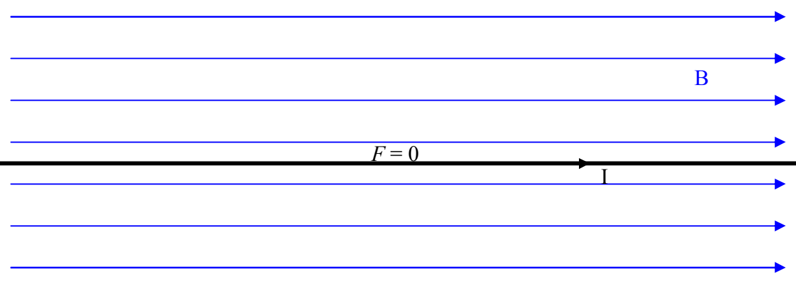
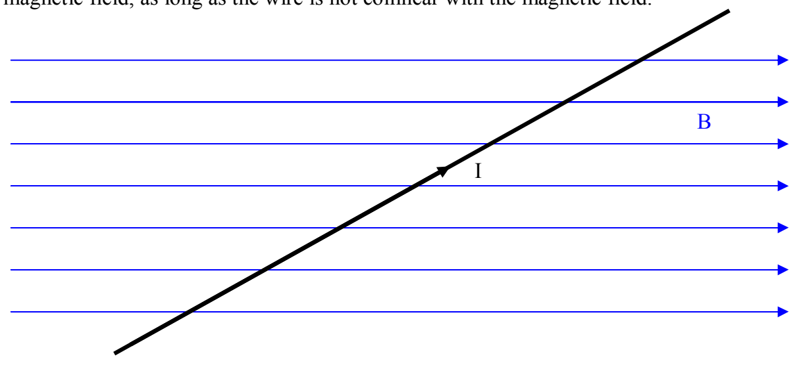

A magnetic field will also interact with a current-carrying conductor. We focus our attention on the case of a straight current-carrying wire segment in a magnetic field:

FACT: Given a straight, current carrying conductor in a magnetic field, the magnetic field exerts no force on the wire segment if the wire segment lies along the line along which the magnetic field is directed. (Note: The circuit used to cause the current in the wire must exist, but, is not shown in the following diagram.)

FACT: A magnetic field exerts a force on a current-carrying wire segment that is in the magnetic field, as long as the wire is not collinear with the magnetic field.

