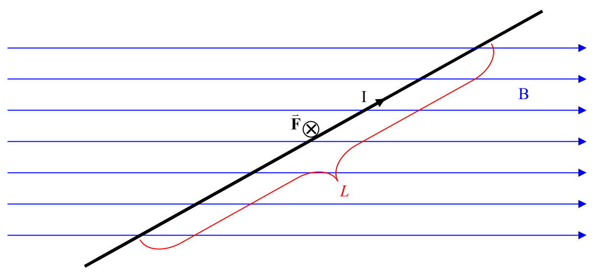

The force exerted on a straight current-carrying wire segment, by the (uniform) magnetic field in which the wire is located, is given by

$$\overrightarrow{\mathbf{F}} = I \overrightarrow{\mathbf{L}} \times \overrightarrow{\mathbf{B}} \tag{16-2}$$

where:

$\overrightarrow{\mathbf{F}}$ is the force exerted on the wire-segment-with-current by the magnetic field the wire is in, $I$ is the current in the wire,

$\overrightarrow{\mathbf{L}}$ is a vector whose magnitude is the length of that segment of the wire which is actually in the magnetic field, and, whose direction is the direction of the current (which depends both on how the wire segment is oriented and how it is connected in the (not-shown) circuit.)

$\overrightarrow{\mathbf{B}}$ is the magnetic field vector. The magnetic field must be uniform along the entire length of the wire for this formula to apply, so, $\overrightarrow{\mathbf{B}}$ is the magnetic field vector at each and every point along the length of the wire.

Note that, in the preceding diagram, $\overrightarrow{\mathbf{F}}$ is directed into the page as determined from $\overrightarrow{\mathbf{F}} = I \overrightarrow{\mathbf{L}} \times \overrightarrow{\mathbf{B}}$ by means of the right-hand rule for the cross product of two vectors.
