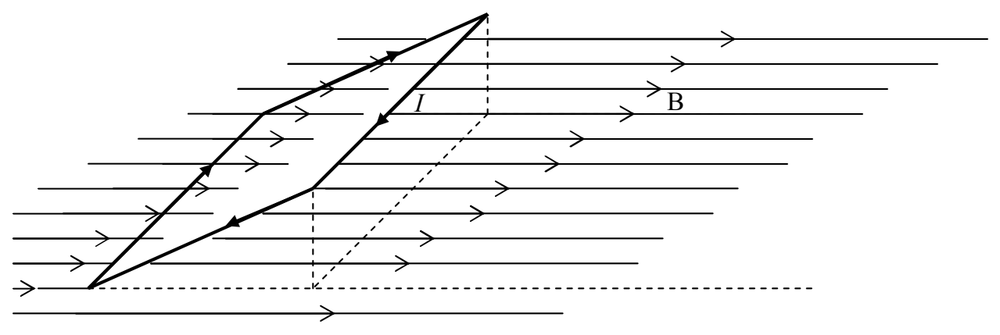
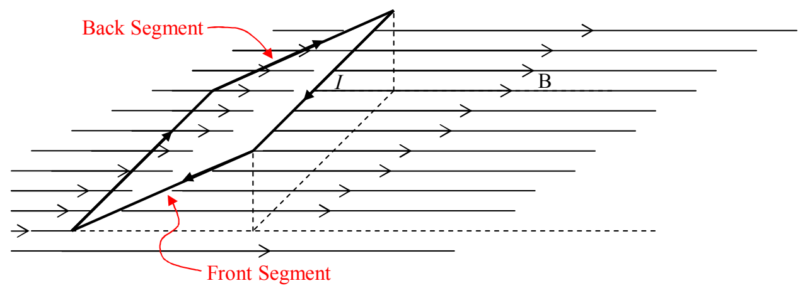

## Effect of a Uniform Magnetic Field on a Current Loop

Consider a rectangular loop of wire. Suppose the loop to be in a uniform magnetic field as depicted in the following diagram:

Note that, to keep things simple, we are not showing the circuitry that causes the current in the loop and we are not showing the cause of the magnetic field. Also, the magnetic field exists throughout the region of space in which the loop finds itself. We have not shown the full extent of either the magnetic field lines depicted, or, the magnetic field itself.

Each segment of the loop has a force exerted on it by the magnetic field the loop is in. Let's consider the front and back segments first:

Because both segments have the same length, both segments make the same angle with the same magnetic field, and both segments have the same current; the force  $\vec{F}=I\vec{L}\times\vec{B}$  will be of the same magnitude in each. (If you write the magnitude as  $F=ILB\sin\theta$ , you know the magnitudes are the same as long as you know that for any angle  $\theta$ ,  $\sin(\theta)=\sin(180^{\circ}-\theta)$ .) Using the right-hand rule for the cross product to get the direction, we find that each force is directed perpendicular to the segment upon which it acts, and, away from the center of the rectangle:
