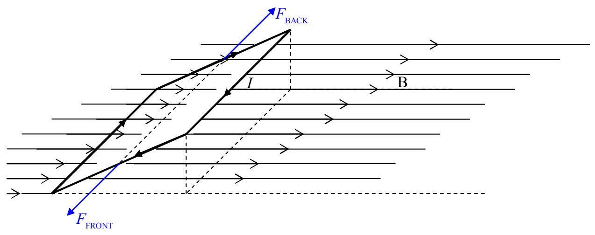
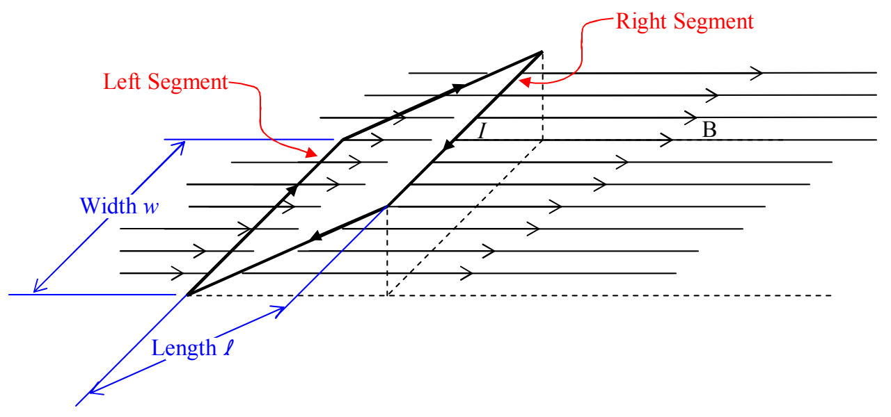

The two forces,  $F_{FRONT}$  and  $F_{BACK}$  are equal in magnitude, collinear, and opposite in direction. About the only effect they could have would be to stretch the loop. Assuming the material of the loop is rigid enough not to stretch, the net effect of the two forces is no effect at all. So, we can forget about them and focus our attention on the left and right segments in the diagram.

Both the left segment and the right segment are at right angles to the magnetic field. They are also of the same length and carry the same current. For each, the magnitude of  $\vec{F}=I\vec{L}\times\vec{B}$  is just IwB where w is the width of the loop and hence the length of both the left segment and the right segment.

Using the right-hand rule for the cross product of two vectors, applied to the expression  $\vec{F}=I\vec{L}\times\vec{B}$  for the force exerted on a wire segment by a magnetic field, we find that the force F=IwB on the right segment is upward and the force F=IwB on the left segment is downward.
