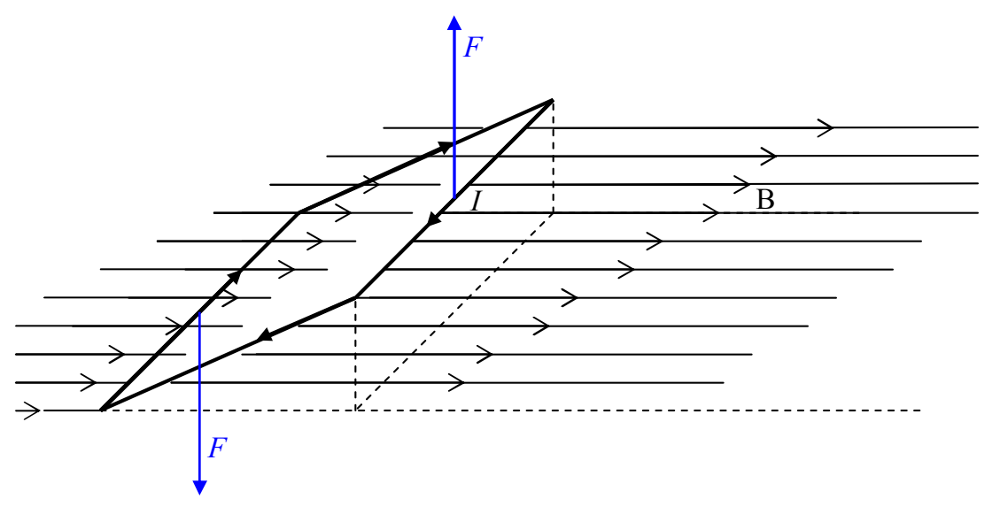
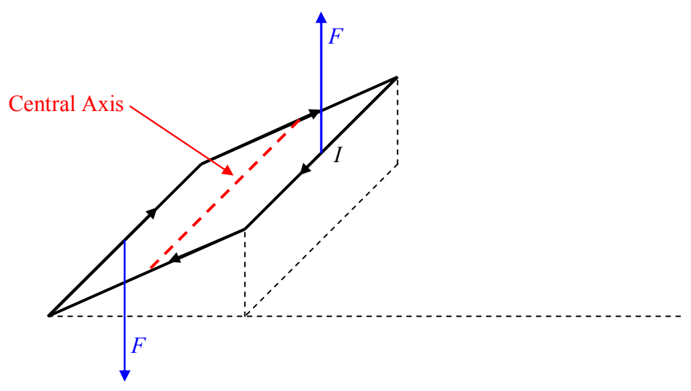

The two forces are equal (both have magnitude  $F = IwB$ ) and opposite in direction, but, they are not collinear. As such, they will exert a net torque on the loop. We can calculate the torque about the central axis:

by extending the lines of action of the forces and identifying the moment arms:
