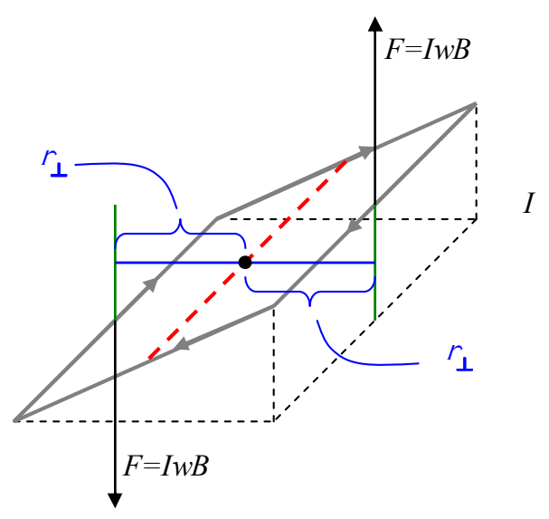
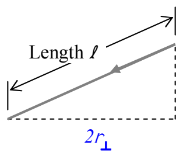
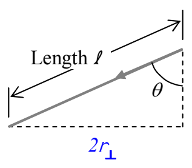

The torque provided by each force is $r_\perp F$. Both torques are counterclockwise as viewed in the diagram. Since they are both in the same direction, the magnitude of the sum of the torques is just the sum of the magnitudes of the two torques, meaning that the magnitude of the total torque is just $\tau = 2 r_\perp F$. We can get an expression for $2r_\perp$ by recognizing, in the diagram, that $2 r_\perp$ is just the distance across the bottom of the triangle in the front of the diagram:

and defining the angle $\theta$, in the diagram, to be the angle between the plane of the loop and the vertical.

From the diagram, it is clear that $2 r_\perp = \ell \sin \theta$.
