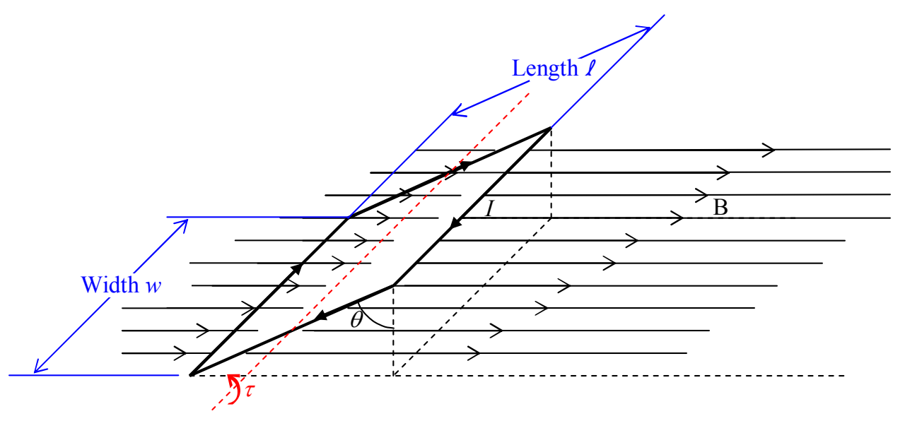

Thus the magnetic field exerts a torque of magnitude

$$
\tau = r _ {\perp} F
$$

$$
\tau = \left[ \ell (\sin \theta) \right] (I w B)
$$

on the current loop.

The expression for the torque can be written more concisely by first reordering the multiplicands so that the expression appears as

$$
\tau = I \ell w B \sin \theta
$$

and then recognizing that the product $\ell w$ is just the area $A$ of the loop. Replacing $\ell w$ with $A$ yields:

$$
\tau = I A B \sin \theta
$$

Torque is something that has direction, and, you might recognize that $\sin\theta$ appearing in the preceding expression as something that can result from a cross product. Indeed, if we define an area vector to have a magnitude equal to the area of the loop,

$$
\left| \vec {\mathbf {A}} \right| = \ell w
$$

and, a direction perpendicular to the plane of the loop,
