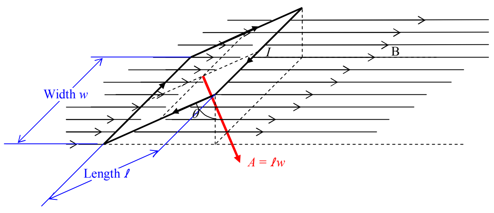
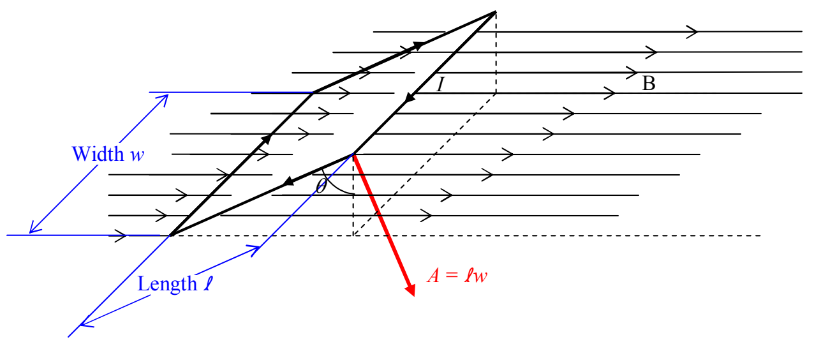

we can write the torque as a cross product. First note that the area vector as I have defined it in words to this point, could point in the exact opposite direction to the one depicted in the diagram. If, however, we additionally stipulate that the area vector is directed in accord with the right-hand rule for something curly something straight, with the loop current being the something curly and the area vector the something straight (and we do so stipulate), then the direction of the area vector is uniquely determined to be the direction depicted in the diagram.

Now, if we slide that area vector over to the right front corner of the loop,

it becomes more evident (you may have already noticed it) that the angle between the area vector  $\vec{A}$  and the magnetic field vector  $\vec{B}$ , is the same  $\theta$  defined earlier and depicted in the diagram just above.
