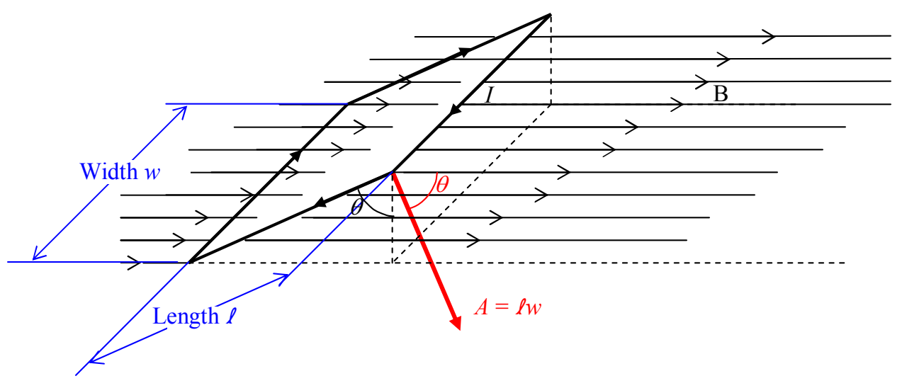
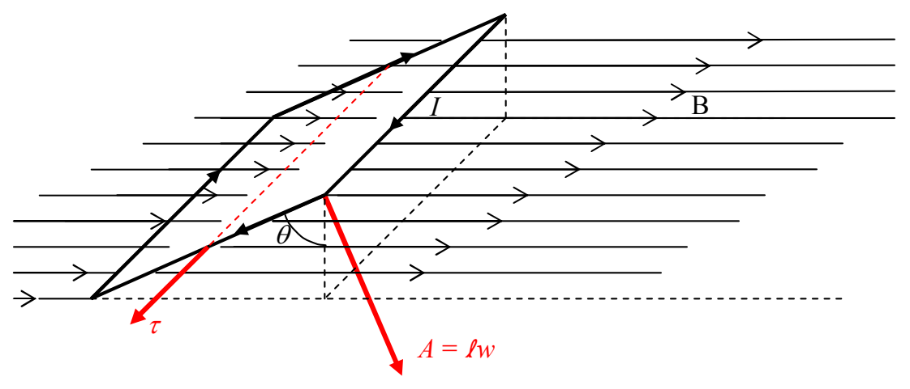

This allows us to write our expression for the torque $\tau = IAB \sin \theta$ counterclockwise as viewed in the diagram, as:

$$
\vec {\boldsymbol {\tau}} = I \vec {\mathbf {A}} \times \vec {\mathbf {B}}
$$

Check it out. The magnitude of the cross product $\left|\vec{A}\times\vec{B}\right|$ is just $AB\sin\theta$, meaning that our new expression yields the same magnitude $\tau=IAB\sin\theta$ for the torque as we had before.

Furthermore, the right-hand rule for the cross product of two vectors yields the torque direction depicted in the following diagram.

Recalling that the sense of rotation associated with an axial vector is determined by the right-hand rule for something curly, something straight; we point the thumb of our cupped right hand in the direction of the torque vector and note that our fingers curl around counterclockwise, as viewed in the diagram.
