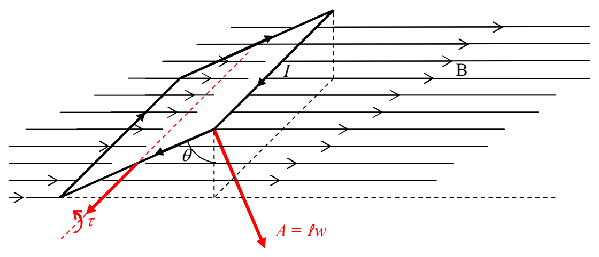

Okay, we're almost there. So far, we have the fact that if you put a loop of wire carrying a current $I$ in it, in a uniform magnetic field $\vec{\mathbf{B}}$, with the loop oriented such that the area vector $\vec{\mathbf{A}}$ of the current loop makes an angle $\theta$ with the magnetic field vector, then, the magnetic field exerts a torque

$$\vec{\boldsymbol{\tau}} = I \vec{\mathbf{A}} \times \vec{\mathbf{B}}$$

on the loop.

This is identical to what happens to a magnetic dipole when you put it in a uniform magnetic field. It experiences a torque $\vec{\tau} = \vec{\mu} \times \vec{B}$. In fact, if we identify the product $I\vec{A}$ as the magnetic dipole moment of the current loop, then the expressions for the torque are completely identical:

$$\vec{\boldsymbol{\tau}} = \vec{\boldsymbol{\mu}} \times \vec{\mathbf{B}} \tag{16-3}$$

where:

$\vec{\tau}$ is the torque exerted on the victim. The victim can be either a particle that has an inherent magnetic dipole moment, or, a current loop.

$\vec{\mu}$ is the magnetic dipole moment of the victim. If the victim is a particle, $\vec{\mu}$ is simply the magnitude and direction of the inherent magnetic dipole moment of the particle. If the victim is a current loop, then $\vec{\mu} = I\vec{A}$ where $I$ is the current in the loop and $\vec{A}$ is the area vector of the loop, a vector whose magnitude is the area of the loop and whose direction is the direction in which your right thumb points when you curl the fingers of your right hand around the loop in the direction of the current. (See the discussion below for the case in which the victim is actually a coil of wire rather than a single loop.)

$\vec{B}$ is the magnetic field vector at the location of the victim.
