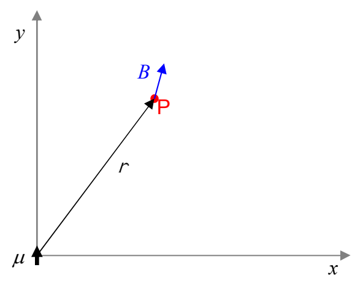

## Example

A particle is at the origin of a Cartesian coordinate system. The magnetic dipole moment of the particle is $1.0\ \text{A} \cdot \text{m}^2\ \hat{\jmath}$. Find the magnetic field vector, due to the particle, at (3.0 cm, 4.0 cm).

## Solution

I’m going to start with a diagram of the configuration.

Note that I do *not* know the direction of B in advance, so, I have drawn $\vec{\mathbf{B}}$ on the diagram in a fairly arbitrary direction. I did want to put $\vec{\mathbf{B}}$ on there to make it more evident that we are dealing with the magnetic field at point P, caused by the particle at the origin. Also, I intentionally drew $\vec{\mathbf{B}}$ in a direction other than that of $\vec{\mathbf{r}}$, to avoid conveying the false impression that $\vec{\mathbf{B}}$ is necessarily in the direction of $\vec{\mathbf{r}}$. (At some points, it is, but those points are the exception. In general, $\vec{\mathbf{B}}$ is *not* in the same direction as $\vec{\mathbf{r}}$. As we shall soon see, for the case at hand, it turns out that $\vec{\mathbf{B}}$ is *not* in the same direction as $\vec{\mathbf{r}}$.)

Given $x = 0.030\ \text{m}$ and $y = 0.040\ \text{m}$, the position vector, for point P is $\vec{\mathbf{r}} = 0.030\ \text{m}\ \hat{\imath} + 0.040\ \text{m}\ \hat{\jmath}$. The magnitude of $\vec{\mathbf{r}}$ is given by:

$$r = \sqrt{x^2 + y^2}$$

$$r = \sqrt{(.030\ \text{m})^2 + (.040\ \text{m})^2}$$

$$r = .050\ \text{m}$$

The unit vector $\hat{\mathbf{r}}$ is thus given by:
