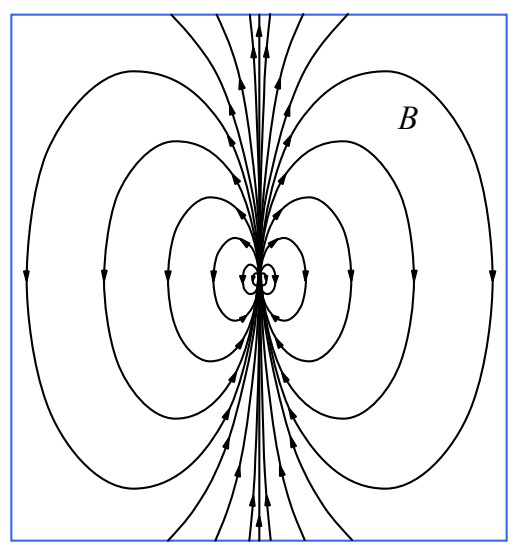

$$\hat{\mathbf{r}} = \frac{\vec{\mathbf{r}}}{r}$$

$$\hat{\mathbf{r}} = \frac{0.030 \mathrm{m} \hat{\imath} + 0.040 \mathrm{m} \hat{\jmath}}{0.050 \mathrm{m}}$$

$$\hat{\mathbf{r}} = 0.60 \hat{\imath} + 0.80 \hat{\jmath}$$

Substituting what we have into our expression for $\vec{\mathbf{B}}$ we find:

$$\vec{\mathbf{B}} = \frac{\mu_{\mathrm{o}}}{4\pi} \frac{3(\vec{\boldsymbol{\mu}} \cdot \hat{\mathbf{r}}) \hat{\mathbf{r}} - \vec{\boldsymbol{\mu}}}{r^3}$$

$$\vec{\mathbf{B}} = \frac{4\pi \times 10^{-7} \mathrm{T \cdot m/A}}{4\pi} \frac{3 \left[ \left(1.0 \mathrm{A \cdot m^2} \hat{\jmath}\right) \cdot \left(0.60 \hat{\imath} + 0.80 \hat{\jmath}\right) \right] \left(0.60 \hat{\imath} + 0.80 \hat{\jmath}\right) - 1.0 \mathrm{A \cdot m^2} \hat{\jmath}}{(.050 \mathrm{m})^3}$$

$$\vec{\mathbf{B}} = 1 \times 10^{-7} \frac{\mathrm{T \cdot m}}{\mathrm{A}} \frac{3 \left[ 0.80 \mathrm{A \cdot m^2} \right] (0.60 \hat{\imath} + 0.80 \hat{\jmath}) - 1.0 \mathrm{A \cdot m^2} \hat{\jmath}}{(.050 \mathrm{m})^3}$$

$$\vec{\mathbf{B}} = 1 \times 10^{-7} \frac{\mathrm{T \cdot m}}{\mathrm{A}} \frac{1.44 \mathrm{A \cdot m^2} \hat{\imath} + 1.92 \mathrm{A \cdot m^2} \hat{\jmath} - 1.0 \mathrm{A \cdot m^2} \hat{\jmath}}{(.050 \mathrm{m})^3}$$

$$\vec{\mathbf{B}} = 1 \times 10^{-7} \frac{\mathrm{T \cdot m}}{\mathrm{A}} \frac{1.44 \mathrm{A \cdot m^2} \hat{\imath} + 0.92 \mathrm{A \cdot m^2} \hat{\jmath}}{(.050 \mathrm{m})^3}$$

$$\vec{\mathbf{B}} = 1 \times 10^{-7} \frac{\mathrm{T \cdot m}}{\mathrm{A}} \left(11520 \frac{\mathrm{A}}{\mathrm{m}} \hat{\imath} + 7360 \frac{\mathrm{A}}{\mathrm{m}} \hat{\jmath}\right)$$

$$\vec{\mathbf{B}} = 1.152 \mathrm{mT} \hat{\imath} + .736 \mathrm{mT} \hat{\jmath}$$

So ends our solution to the sample problem. Here’s a magnetic field diagram of the magnetic field due to a particle that has a magnetic dipole moment.

