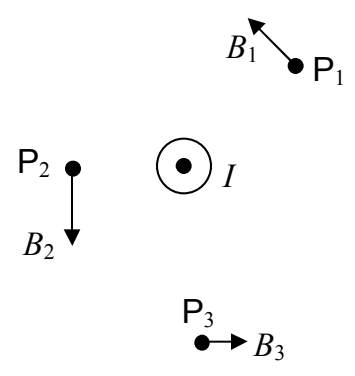
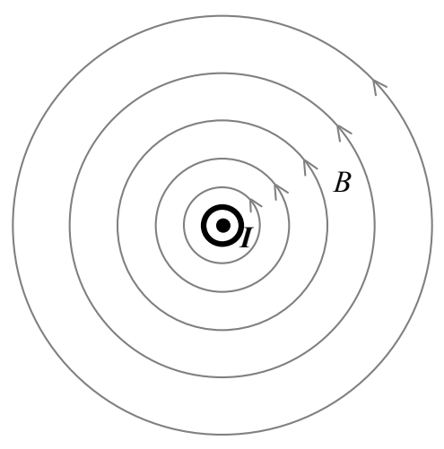

Consider the case of a long straight wire carrying current straight at you. The magnetic field at a few points is depicted in the diagram below (where the empty points in space in question are labeled  $P_{1}$ ,  $P_{2}$ , and  $P_{3}$ .)

While the magnetic field vector at any point in space is, of course, directed along a straight line, the overall pattern of the magnetic field lines in the vicinity of a long straight wire segment, in a plane perpendicular to the wire segment, forms circles around the wire. The magnetic field lines are directed tangent to the circles, and, the direction is given by the right hand rule for something curly something straight. The magnetic field line pattern is the something curly and the current in the straight wire is the something straight. Point your right thumb in the direction of the current and the fingers of your cupped right hand curl around in the direction of the magnetic field lines.

