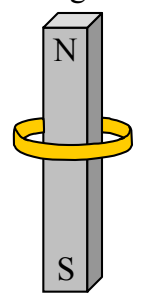
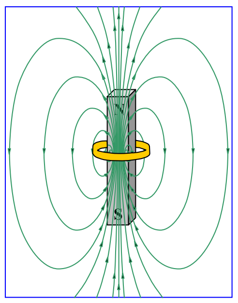

## 18 Faraday's Law, Lenz's Law

Do you remember Archimedes's Principle? We were able to say something simple, specific, and useful about a complicated phenomenon. The gross idea was that a submerged object being pressed upon on every surface element in contact with fluid, by the fluid, experiences a net upward force because the pressure in a fluid is greater at greater depth. The infinite sum, over all the surface area elements of the object in contact with the fluid, of the force of magnitude pressure-times-the-area, and direction normal to and into the area element, resulted in an upward force that we called the buoyant force. The thing is, we were able to prove that the buoyant force is equal in magnitude to the weight of that amount of fluid that would be where the object is if the object wasn't there. Thus we can arrive at a value for the buoyant force without having to even think about the vector integration of pressure-related force that causes it.

We are about to encounter another complicated phenomenon which can be characterized in a fruitful fashion by a relatively simple rule. I’m going to convey the idea to you by means of a few specific processes, and then sum it up by stating the simple rule.

Consider a gold $^{1}$ ring and a bar magnet in the hands of a person. The person is holding the ring so that it encircles the bar magnet. She is holding the magnet, north end up.

There is a magnetic field, due to the bar magnet, within the bar magnet, and in the region of space around it.

$^{1}$  Any conductive material will do here. I chose gold arbitrarily.
