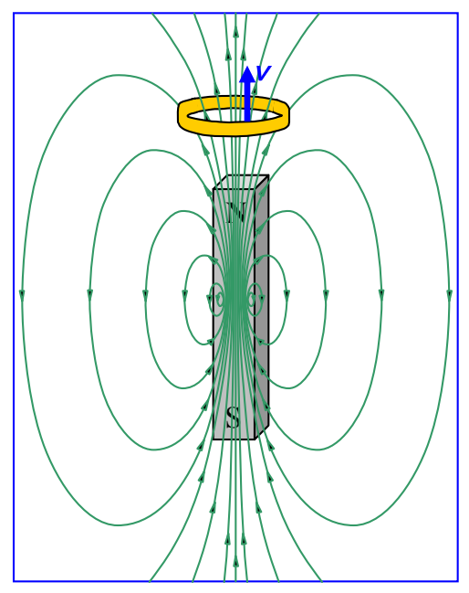
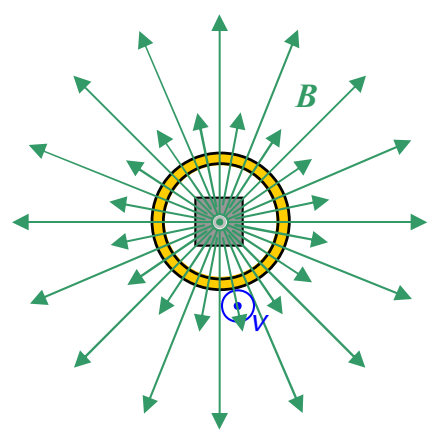

It is important to note that the magnetic field lines are most densely packed inside the bar magnet.

Now suppose that the person, holding the magnet at rest in one hand, moves the loop upward. I want to focus on what is going on while she is moving it upward. As she moves the loop upward, she is moving it roughly along the direction of the magnetic file lines, but, and this is actually the important part, that loop will also be “cutting through” some magnetic field lines. Consider an instant in time when the loop is above the magnet, and moving upward:

From above, the scene looks like:

where it is important to realize that none of those magnetic field lines begin on the magnet or end at the tip of the arrow depicted, rather, they extend out of the magnet toward us, flower out and over, back down away from us, and then they loop around to enter the south pole of the magnet from which they extend back up through the magnet toward us. In fact, no magnetic field line ever begins or ends anywhere. They all form closed loops. This is a manifestation of the fact that there is no such thing as magnetic charge. (There are no magnetic monopoles.)
