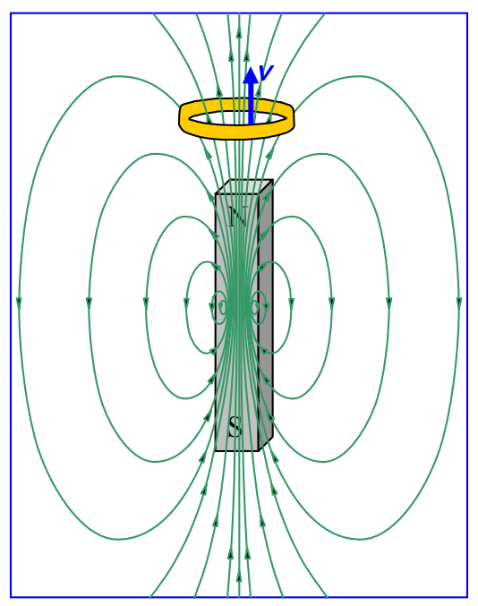
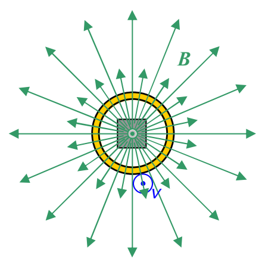

View From Above

Here’s where we’re going with this:  The motion of the ring relative to the magnet is going to cause a current in the ring.  Here’s how:  The ring is neutral, but, it is chock full of charged particles that are free to move around within the gold.  [I’m going to discuss it in our positive charge carrier model but you can verify that you get the same result if the charge carriers are negative (recalling that our current is in the direction opposite that in which negative charge carriers are moving.)]  Pick any short segment of the ring and get the direction of the force exerted on the charge carriers of that segment using $\vec{\mathbf{F}}=q\vec{\mathbf{v}}\times\vec{\mathbf{B}}$ and the right-hand rule for the cross product of two vectors.  In the view from above, all we can see is the horizontal component of the magnetic field vectors in the vicinity of the moving ring but that’s just dandy; the vertical component, being parallel to the ring’s velocity (and hence parallel to the velocity of the charge in the ring), makes no contribution to $\vec{\mathbf{v}}\times\vec{\mathbf{B}}$.  Now, pick your segment of the ring.  Make your fingers point away from your elbow, and, in the direction of the first vector (the velocity vector) in $\vec{\mathbf{v}}\times\vec{\mathbf{B}}$, namely, “out of the page”.  Now, keeping your fingers pointing both away from your elbow, and, out of the page, rotate your forearm as necessary so that your palm is facing in the direction of $\vec{\mathbf{B}}$ (at the location of the segment you are working on), meaning that if you were to close your fingers, they would point in the direction of $\vec{\mathbf{B}}$.  Your extended thumb is now pointing in the direction of the force exerted on the positive charge carriers in the ring segment you chose.  No matter what ring segment you pick, the force is always in that direction which tends to push the positive charge carriers counterclockwise around the ring!  The result is a counterclockwise (as viewed from above) current in the ring.

Suppose that, starting with the ring encircling the magnet, the person who was holding the ring and the magnet moved the magnet downward rather than moving the ring upward.  She holds the ring stationary, and moves the magnet.  I said earlier that a charged particle at rest in a magnetic field has no force exerted on it by the magnetic field.  But we were talking about stationary magnetic fields at the time.  Now we are talking about the magnetic field of a magnet that is moving.  Since the magnet responsible for it is moving, the magnetic field itself must be moving.  Will that result in a force on the charges in the ring (and hence a current in the ring)?  This brings us to a consideration of relative motion.  To us, the two processes (person moves ring upward
