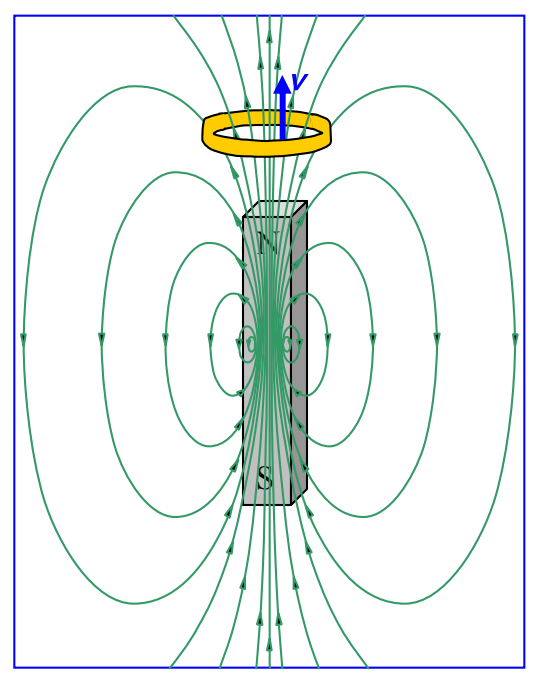
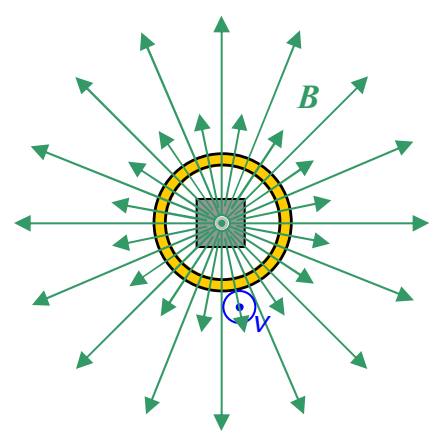

Looking at the diagrams of that ring moving relative to the magnet again,

View From Above

we can describe what's happening by saying that the ring is “cutting through” magnetic field lines (or, equivalently, by saying that the magnetic field lines are “cutting through” the ring). What Faraday recognized was that, in conceptual terms, by the ring cutting through magnetic field lines (or vice versa depending on your point of view), what was happening was, that the number of magnetic field lines encircled by the loop was changing. In the diagrams above, each time the ring “cuts through” one more field line, the number of field lines encircled by the loop decreases by one. The rate at which the ring “cuts through” magnetic field lines (or the magnetic field lines cut through the ring) is determined by the same things that determine the force on the charged particles making up the ring (relative speed between ring and magnetic field, strength of magnetic field, relative orientation of velocity of ring and magnetic field) such that, the greater the rate at which the ring “cuts through” magnetic field lines (or the greater the rate at which magnetic field lines cut through the ring), the greater the force on the charged particles and hence the greater the current. Faraday expressed this in a manner that is easier to analyze. He said that the current is determined by the rate at which the number of magnetic field lines encircled by the loop is changing. In fact, Faraday was able to write this statement in equation form. Before I show you that, I have to be a lot more specific about what I mean by “the number of magnetic field lines.”

I'm going to call the statement I have just attributed to Faraday, the conceptual form of Faraday's Law. In other words, Faradays Law, in conceptual form is: A changing number of magnetic field lines through a closed loop or coil causes a current in that loop or coil, and, the faster the number is changing, the greater the current.
