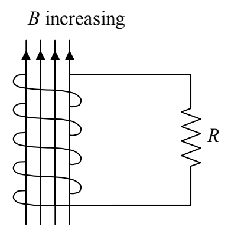

Faraday’s Law, the one that says that the current induced in a loop or coil is proportional to the rate of change in the number of magnetic field lines encircled by the loop or coil, can be written in terms of the flux as:

$$I = -\frac{N}{R} \frac{d\Phi_{\text{B}}}{dt}$$

where:

$N$ is the number of windings or turns making up the closed coil of wire. $N = 1$ for a single loop.

$R$ is the resistance of the loop or coil.

$\frac{d\Phi_{\text{B}}}{dt}$ is the rate of change in the flux through the loop.

The derivative of a function with respect to *time* is often abbreviated as the function itself with a dot over it. In other words,

$$\dot{\Phi}_{\text{B}} = \frac{d\Phi_{\text{B}}}{dt}$$

Using this notation in our expression for the current in Faradays Law of induction we have:

$$I = -\frac{N}{R} \dot{\Phi}_{\text{B}}$$

Faraday’s Law is usually expressed in terms of an EMF rather than a current. I’m going to use a specific case study to develop the idea which is of general applicability. Consider a coil of *ideally-conducting* wire in series with a resistor. For closure of the loop, the resistor is to be considered part of the loop (and hence is the resistance *of* the loop), but, we have a negligible number of magnetic field lines cutting through the resistor itself. Suppose there to be an increasing magnetic flux directed upward through the coil.

