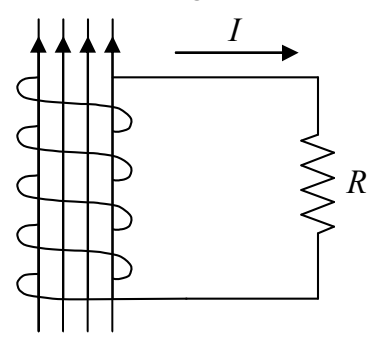
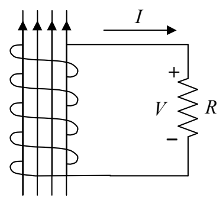

By Faraday's Law of Induction, there will be a current $I = -\frac{N}{R}\dot{\Phi}_{\mathrm{B}}$ induced in the coil. The charge will flow around and around the coil, out the top of the coil and down through the resistor.

$B$ increasing

But, for a resistor to have a current in it, there must be a potential difference V = IR between the terminals of the resistor.

$B$ increasing

Recognizing that, in the case at hand, the I in V = IR is the  $I = -\frac{N}{R} \dot{\Phi}_{B}$  resulting from the changing magnetic flux through the coil, we have

$$V = \left(- \frac {N}{R} \dot {\Phi} _ {\mathrm{B}}\right) R$$

which we can write as

$$V = - N \dot {\Phi} _ {\mathrm{B}}$$
