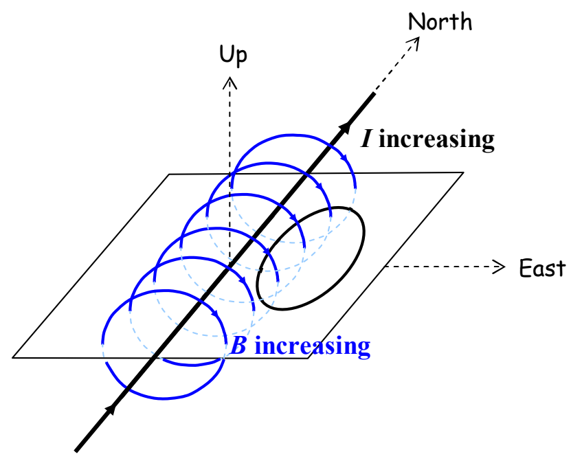

## 19 Induction, Transformers, and Generators

In this chapter we provide examples chosen to further familiarize you with Faraday's Law of Induction and Lenz's Law. The last example is the generator, the device used in the world's power plants to convert mechanical energy into electrical energy.

## Example 19-1

A straight wire carries a current due northward. Due east of the straight wire, at the same elevation as the straight wire, is a horizontal loop of wire. The current in the straight wire is increasing. Which way is the current, induced in the loop by the changing magnetic field of the straight wire, directed around the loop?

## Solution

I'm going to draw the given situation from a few different viewpoints, just to help you get used to visualizing this kind of situation. As viewed from above-and-to-the-southeast, the configuration (aside from the fact that magnetic field lines are invisible) appears as:

where I included a sheet of paper in the diagram to help you visualize things.
