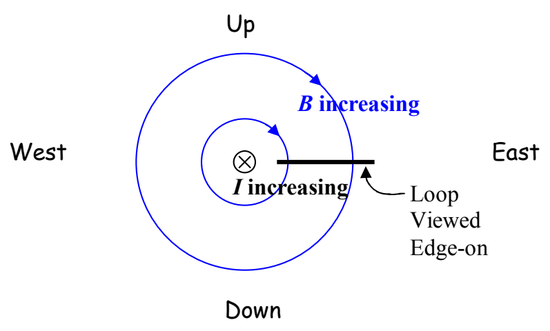
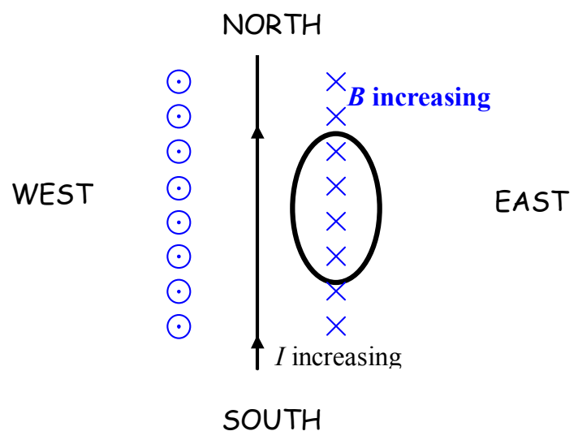

Here's a view of the same configuration from the south, looking due north:

Both diagrams make it clear that we have an increasing number of downward-directed magnetic field lines through the loop. It is important to keep in mind that a field diagram is a diagrammatic manner of conveying information about an infinite set of vectors. There is no such thing as a curved vector. A vector is always directed along a straight line. The magnetic field vector is tangent to the magnetic field lines characterizing that vector. At the location of the loop, every magnetic field vector depicted in the diagram above is straight downward. While it is okay to say that we have an increasing number of magnetic field lines directed downward through the loop, please keep in mind that the field lines characterize vectors.

In presenting my solution to the example question, “What is the direction of the current induced in a horizontal loop that is due east of a straight wire carrying an increasing current due north?” I wouldn’t draw either one of the diagrams above. The first one takes too long to draw and there is no good way to show the direction of the current in the loop in the second one. The view from above is the most convenient one:

