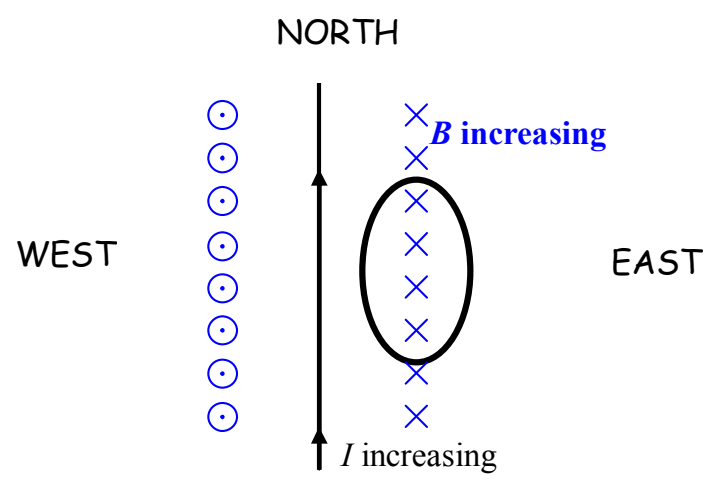
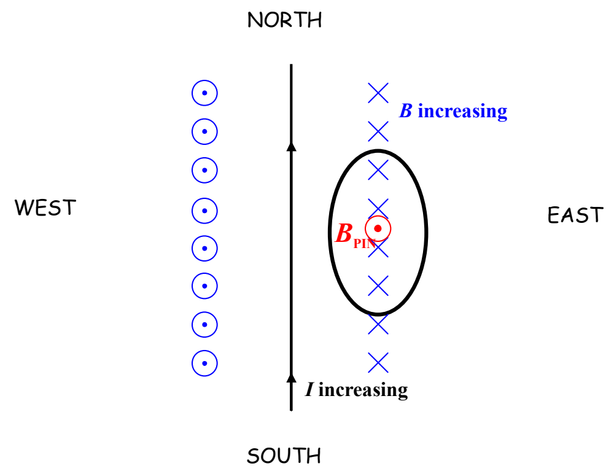

In this view (in which the downward direction is into the page) it is easy to see that what we have is an increasing number of downward-directed magnetic field lines through the loop (more specifically, through the region enclosed by the loop). In its futile attempt to keep the number of magnetic field lines directed downward through the loop the same as what it was, $\vec{\mathbf{B}}_{\text{PIN}}$ must be directed *upward* in order to cancel out the newly-appearing downward-directed magnetic field lines. [Recall the sequence: The changing number of magnetic field lines *induces* (by Faraday’s Law) a current in the loop. That current *produces* (by Ampere’s Law) a magnetic field $(\vec{\mathbf{B}}_{\text{PIN}})$ of its own. Lenz’s Law relates the *end product* $(\vec{\mathbf{B}}_{\text{PIN}})$ to the *original change* (increasing number of downward-through-the-loop magnetic field lines).]

