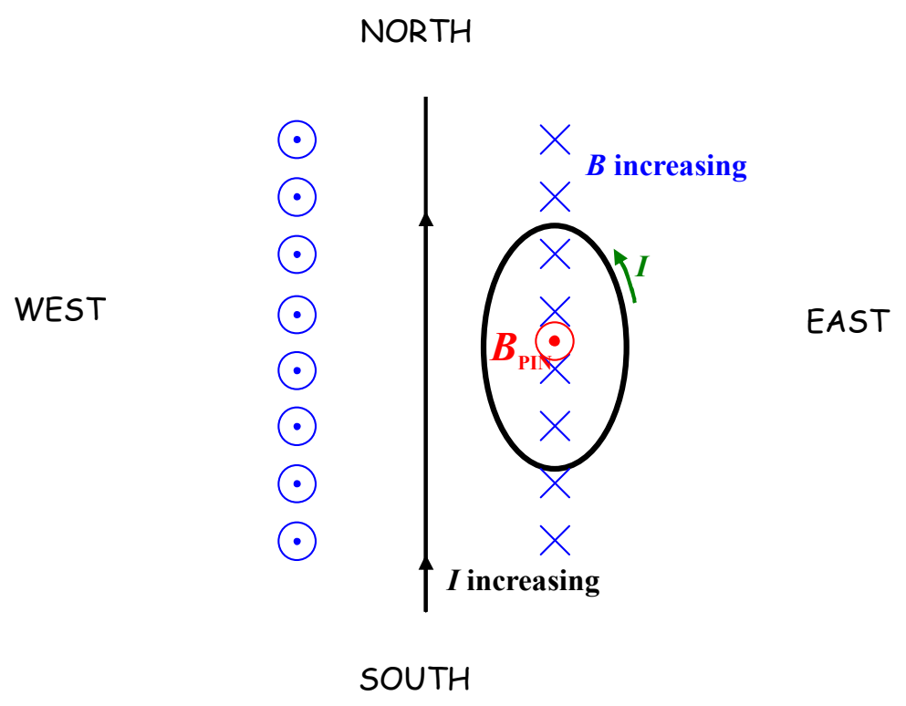

That’s interesting. We know the direction of the magnetic field produced by the induced current before we even known the direction of the induced current itself. So, what must the direction of the induced current be in order to produce an upward-directed magnetic field ($\vec{\mathbf{B}}_{\mathrm{PIN}}$)? Well, by the right-hand rule for something curly something straight, the current must be counterclockwise, as viewed from above.

Hey. That’s the answer to the question. We’re done with that example. Here’s another one:
