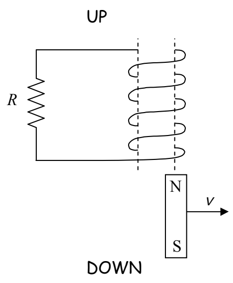
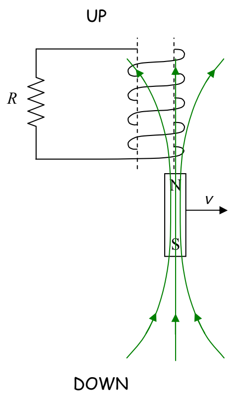

## Example 19-2

A person is moving a bar magnet, aligned north pole up, out from under a coil of wire, as depicted below. What is the direction of the current in the resistor?

The magnetic field of the bar magnet extends upward through the coil.

