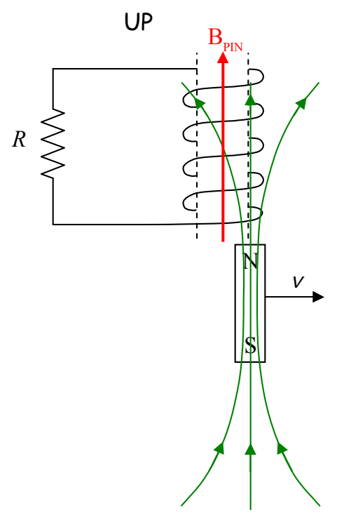
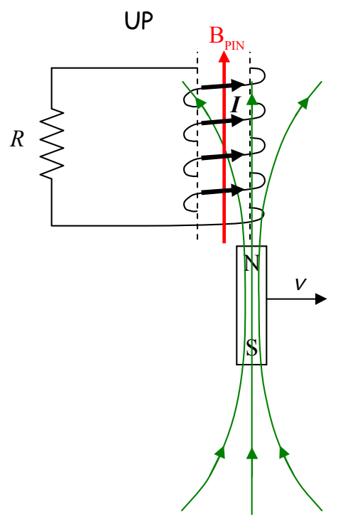

As the magnet moves out from under the coil, it takes its magnetic field with it. So, as regards the coil, what we have is a decreasing number of upward-directed magnetic field lines through the coil. By Faraday’s Law, this induces a current in the coil. By Ampere’s Law, the current produces a magnetic field, $\vec{\mathbf{B}}_{\mathrm{PIN}}$. By Lenz’s Law $\vec{\mathbf{B}}_{\mathrm{PIN}}$ is upward, to make up for the departing upward-directed magnetic field lines through the coil.

So, what is the direction of the current that is causing $\vec{\mathbf{B}}_{\mathrm{PIN}}$? The right-hand rule will tell us that. Point the thumb of your cupped right hand in the direction of $\vec{\mathbf{B}}_{\mathrm{PIN}}$. Your fingers will then be curled around (counterclockwise as viewed from above) in the direction of the current.

