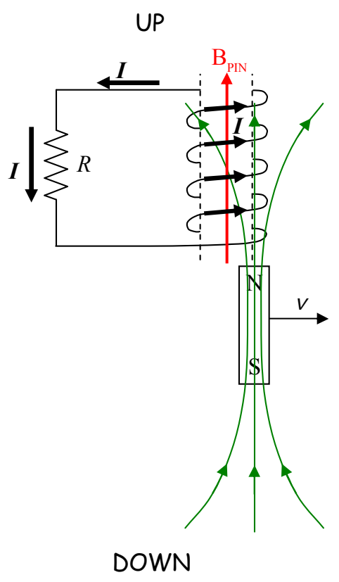

Because of the way the coil is wound, such a current will be directed out the top of the coil downward through the resistor.

That's the answer to the question posed in the example. (What is the direction of the current in the resistor?)
