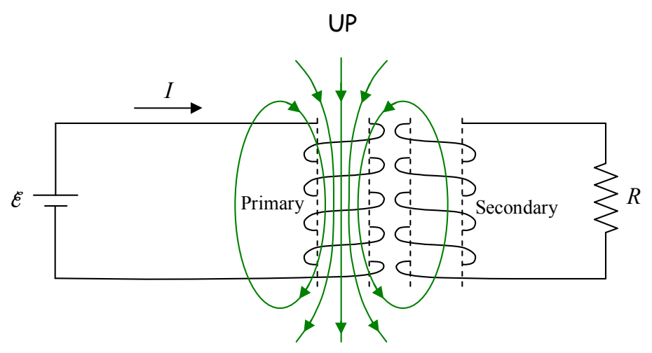
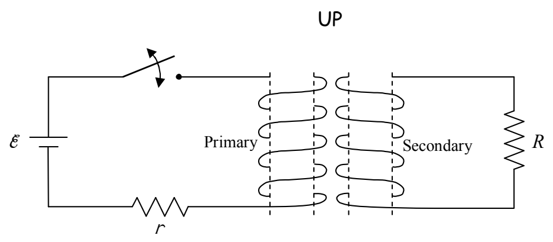

## Example 19-3 The Transformer

When you put two coils of wire near each other, such that when you create a magnetic field by using a seat of EMF to cause a current in one coil, that magnetic field extends through the region encircled by the other coil, you create a transformer. Let’s call the coil in which you initially cause the current, the primary coil, and the other one, the secondary coil.

If you cause the current in the primary coil to be changing, then the magnetic field produced by that coil is changing. Thus, the flux through the secondary coil is changing, and, by Faraday’s Law of Induction, a current will be induced in the secondary coil. One way to cause the current in the primary coil to be changing would be to put a switch in the primary circuit (the circuit in which the primary coil is wired) and to repeatedly open and close it.

Okay, enough preamble, here’s the question: What is the direction of the transient$^{1}$ current induced in the circuit above when the switch is closed?

$^{1}$ (This footnote is about the English language rather than physics.) Transient means existing for a short time interval.
