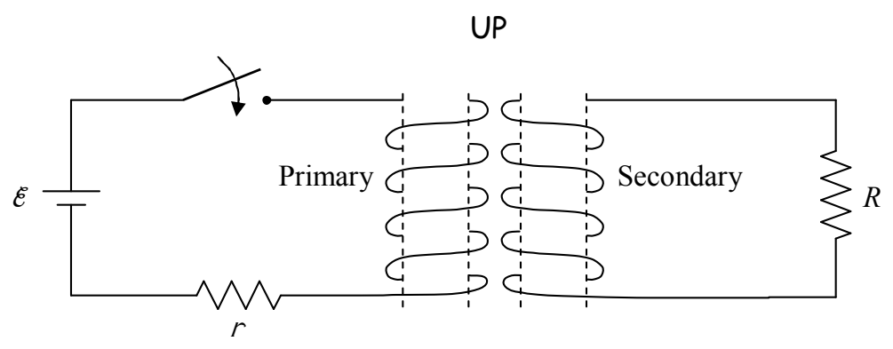
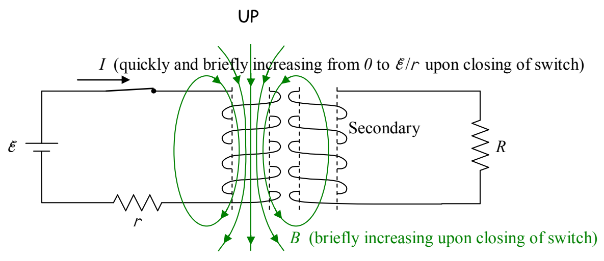

## Solution to Example 19-3:

Upon closing the switch, the current in the primary circuit very quickly builds up to $\mathcal{E}/r$. While the time that it takes for the current to build up to $\mathcal{E}/r$ is very short, it is during this time interval that the current is changing. Hence, it is on this time interval that we must focus our attention in order to answer the question about the direction of the transient current in resistor $R$ in the secondary circuit. The current in the primary causes a magnetic field. Because the current is increasing, the magnetic field vector at each point in space is increasing in magnitude.

The increasing magnetic field causes upward-directed magnetic field lines in the region encircled by the secondary coil. There were no magnetic field lines through that coil before the switch was closed, so clearly, what we have here is an increasing number of upward-directed magnetic field lines through the secondary coil. By Faraday's Law this will induce a current in the coil. By Ampere's law, the current induced in the secondary will produce a magnetic field of its own, one that I like to call $\vec{B}_{\text{PIN}}$ for "The Magnetic field Produced by the Induced Current." By Lenz's Law, $\vec{B}_{\text{PIN}}$ must be downward to cancel out some of the newly-appearing upward-directed magnetic field lines through the secondary. (I hope it is clear that what I call the magnetic field lines through the secondary, are the magnetic field lines passing through the region encircled by the secondary coil.)
