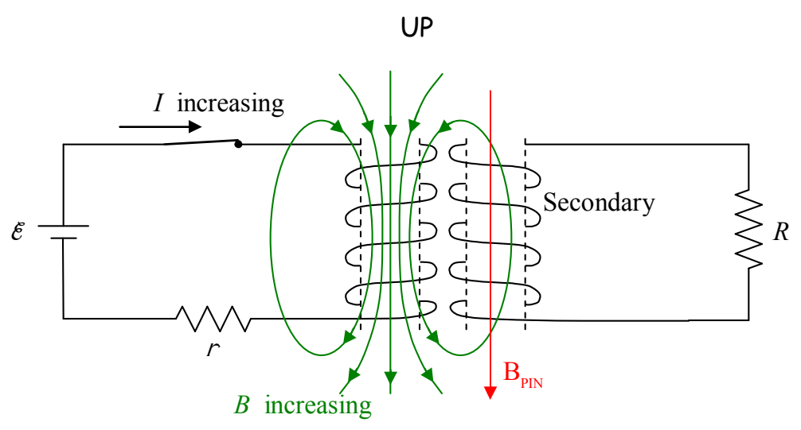
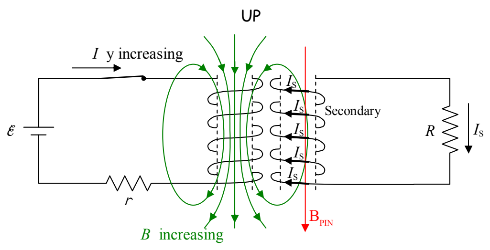

Okay. Now the question is, which way must the current be directed around the coil in order to create the downward-directed magnetic field  $\vec{B}_{PIN}$  that we have deduced it does create. As usual, the right-hand rule for something curly something straight reveals the answer. We point the thumb of the cupped right hand in the direction of  $\vec{B}_{PIN}$  and cannot fail to note that the fingers curl around in a direction that can best be described as “clockwise as viewed from above.”

Because of the way the secondary coil is wound, such a current will be directed out of the secondary at the top of the coil and downward through resistor R. This is the answer to the question posed in the example.
