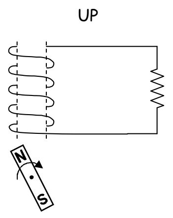
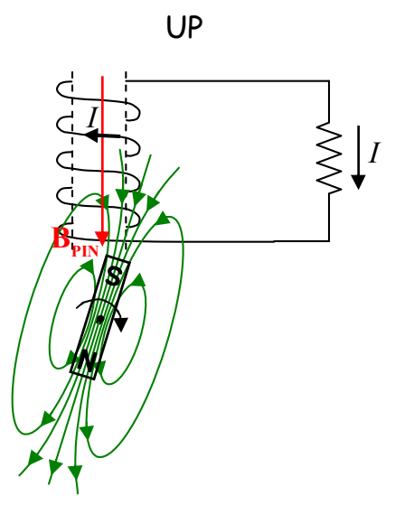

## An Electric Generator

Consider a magnet that is caused to rotate in the vicinity of a coil of wire as depicted below.

As a result of the rotating magnet, the number and direction of the magnetic field lines through the coil is continually changing. This induces a current in the coil, which, as it turns out, is also changing. Check it out in the case of magnet that is, from our viewpoint, rotating clockwise. In the orientation of the rotating magnet depicted here:

as the magnet rotates, the number of its magnetic field lines extending downward through the coil is decreasing. In accord with Faraday’s Law, this induces a current in the coil which, in accord with Ampere’s Law, produces a magnetic field of its own. By Lenz’s Law, the field $(\vec{\mathbf{B}}_{\mathrm{PIN}})$ produced by the induced current must be downward to make up for the loss of downward-directed magnetic field lines through the coil. To produce $\vec{B}_{\text{PIN}}$ downward, the induced current must be clockwise, as viewed from above. Based on the way the wire is wrapped and the coil is connected in the circuit, a current that is clockwise as viewed from above, in the coil, is directed out of the coil at the top of the coil and downward through the resistor.
