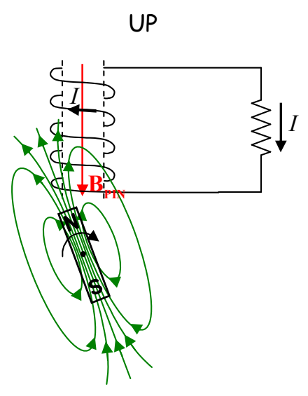
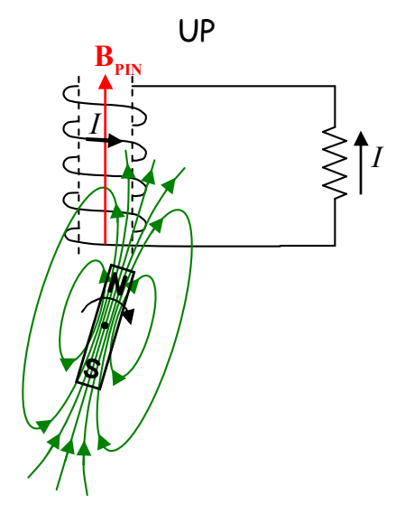

In the following diagrams we show the magnet in each of several successive orientations. Keep in mind that someone or something is spinning the magnet by mechanical means. You can assume for instance that a person is turning the magnet with her hand. As the magnet turns the number of magnetic field lines is changing in a specific manner for each of the orientations depicted. You the reader are asked to apply Lenz's Law and the Right Hand Rule for Something Curley, Something Straight to verify that the current (caused by the spinning magnet) through the resistor is in the direction depicted:

