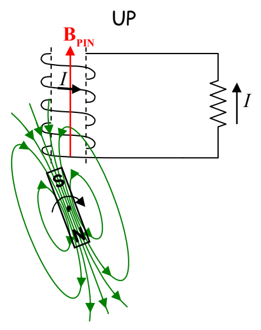
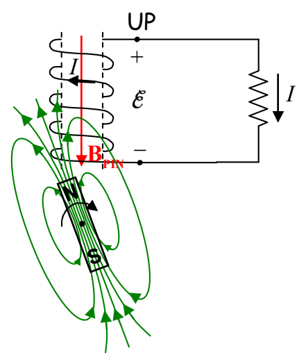

As the magnet continues to rotate clockwise, the next orientation it achieves is our starting point and the process repeats itself over and over again.

Recapping and extrapolating, the current through the resistor in the series of diagrams above, is:

downward, downward, upward, upward, downward, downward, upward, upward, ...

For half of each rotation, the current is downward, and for the other half of each rotation, the current is upward. In quantifying this behavior, one focuses on the EMF induced in the coil:

