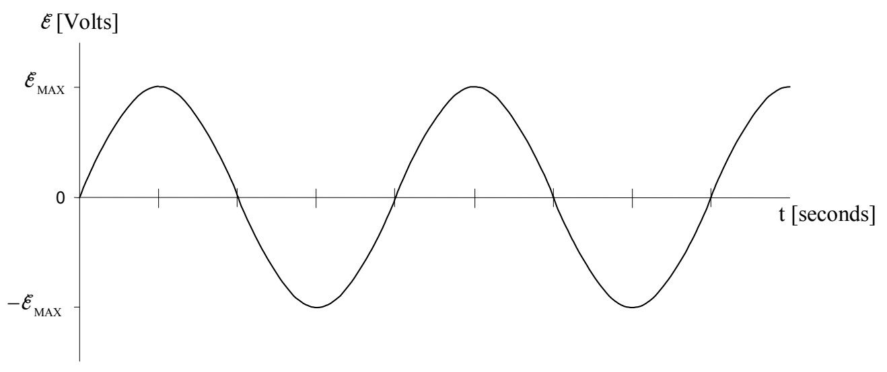
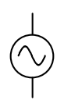

The EMF across the coil varies sinusoidally with time as:

$$
\mathcal {E} = \mathcal {E} _ {\mathrm{MAX}} \sin (2 \pi f t) \tag {19-1}
$$

where:

$\tilde{\varepsilon}$ which stands for EMF, is the time-varying electric potential difference between the terminals of a coil in close proximity to a magnet that is rotating relative to the coil as depicted in the diagrams above. This potential difference is caused to exist, and to vary the way it does, by the changing magnetic flux through the coil.

$\tilde{\varepsilon}_{MAX}$ is the maximum value of the EMF of the coil.

f is the frequency of oscillations of the EMF across the coil. It is exactly equal to the rotation rate of the magnet expressed in rotations per second, a unit that is equivalent to hertz.

The device that we have been discussing (coil-plus-rotating magnet) is called a generator, or more specifically, an electric generator. A generator is a seat of EMF that causes there to be a potential difference between its terminals that varies sinusoidally with time. The schematic representation of such a time-varying seat of EMF is:

It takes work to spin the magnet. The magnetic field caused by the current induced in the coil exerts a torque on the magnet that always tends to slow it down. So, to keep the magnet spinning, one must continually exert a torque on the magnet in the direction in which it is spinning. The generator is the main component of any electrical power plant. It converts mechanical energy to electrical energy. The kind of power plant you are dealing with is determined by what your power company uses to spin the magnet. If moving water is used to
