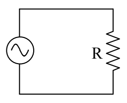

spin the magnet, we call the power plant a hydroelectric plant. If a steam turbine is used to spin the magnet, then the power plant is designated by its method of heating and vaporizing water. For instance, if one heats and vaporizes the water by means of burning coal, one calls the power plant a coal-fired power plant. If one heats and vaporizes the water by means of a nuclear reactor, one calls the power plant a nuclear power plant.

Consider a “device which causes a potential difference between its terminals that varies sinusoidally with time” in a simple circuit:

The time-varying seat of EMF causes a potential difference across the resistor, in this simple circuit, equal, at any instant in time, to the voltage across the time-varying seat of EMF. As a result, there is a current in the resistor. The current is given by $I = \frac{V}{R}$, our defining equation for resistance, solved for the current $I$. Because the algebraic sign of the potential difference across the resistor is continually alternating, the direction of the current in the resistor is continually alternating. Such a current is called an alternating current (AC). It has become traditional to use the abbreviation AC to the extent that we do so in a redundant fashion, often referring to an alternating current as an AC current. (When we need to distinguish it from AC, we call the “one-way” kind of current that, say, a battery causes in a circuit, direct current, abbreviated DC.)

A device that causes current in a resistor, whether that current is alternating or not, is delivering energy to the resistor at a rate that we call power. The power delivered to a resistor can be expressed as $P = IV$ where $I$ is the current through the resistor and $V$ is the voltage across the resistor. Using the defining equation of resistance, $V = IR$, the power can be expressed as $P = I^2 R$. A “device which causes a potential difference between its terminals that varies sinusoidally with time”, what I have been referring to as a “time-varying seat of EMF” is typically referred to as an AC power source. An AC power source is typically referred to in terms of the frequency of oscillations, and, the voltage that a DC power source, an ordinary seat of EMF, would have to maintain across its terminals to cause the same average power in any resistor that might be connected across the terminals of the AC power source. The voltage in question is typically referred to as $\mathcal{E}_{\text{RMS}}$ or $V_{\text{RMS}}$ where the reasoning behind the name of the subscript will become evident shortly.

Since the power delivered by an ordinary seat of EMF is a constant, its average power is the value it always has.
