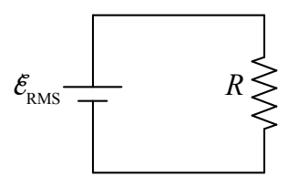
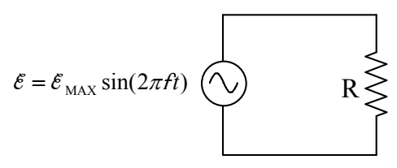

Here’s the fictitious circuit

that would cause the same resistor power as the AC power source in question. The average power (which is just the *power* in the case of a DC circuit) is given by $P_{\text{AVG}} = I \mathcal{E}_{\text{RMS}}$, which, by means of our defining equation of resistance solved for $I$, $I=V/R$, (where the voltage across the resistor is, by inspection, $\mathcal{E}_{\text{RMS}}$) can be written $P_{\text{AVG}} = \frac{\mathcal{E}_{\text{RMS}}^2}{R}$. So far, this is old stuff, with an unexplained name for the EMF voltage. Now let’s consider the AC circuit:

The power is $P = \frac{\mathcal{E}^2}{R} = \frac{[\mathcal{E}_{\text{MAX}} \sin(2\pi ft)]^2}{R} = \frac{\mathcal{E}_{\text{MAX}}^2 [\sin(2\pi ft)]^2}{R}$. The average value of the square of the sine function is $\frac{1}{2}$. So the average power is $P_{\text{AVG}} = \frac{1}{2} \frac{\mathcal{E}_{\text{MAX}}^2}{R}$. Combining this with our expression $P_{\text{AVG}} = \frac{\mathcal{E}_{\text{RMS}}^2}{R}$ from above yields:

$$\frac{\mathcal{E}_{\text{RMS}}^2}{R} = \frac{1}{2} \frac{\mathcal{E}_{\text{MAX}}^2}{R}$$

$$\mathcal{E}_{\text{RMS}} = \sqrt{\frac{1}{2}} \mathcal{E}_{\text{MAX}} \tag{19-2}$$

Now we are in a position to explain why we called the equivalent EMF, $\mathcal{E}_{\text{RMS}}$. In our expression $P_{\text{AVG}} = \frac{1}{2} \frac{\mathcal{E}_{\text{MAX}}^2}{R}$, we can consider $\frac{\mathcal{E}_{\text{MAX}}^2}{2}$ to be the average value of the square of our time-varying EMF $\mathcal{E} = \mathcal{E}_{\text{MAX}} \sin(2\pi ft)$. Another name for “average” is “mean” so we can consider $\frac{\mathcal{E}_{\text{MAX}}^2}{2}$ to be the *mean* value of $\mathcal{E}^2$. On the right side of our expression for our equivalent EMF, $\mathcal{E}_{\text{RMS}} = \frac{1}{\sqrt{2}} \mathcal{E}_{\text{MAX}}$, we have the square root of $\frac{\mathcal{E}_{\text{MAX}}^2}{2}$, that is, we have the *square root* of the *mean* of the *square* of the EMF $\mathcal{E}$. And indeed the subscript “RMS” stands for “root mean squared.” RMS values are convenient for circuits consisting of resistors and AC power sources in that, one can analyze such circuits using RMS values the same way one analyzes DC circuits.
